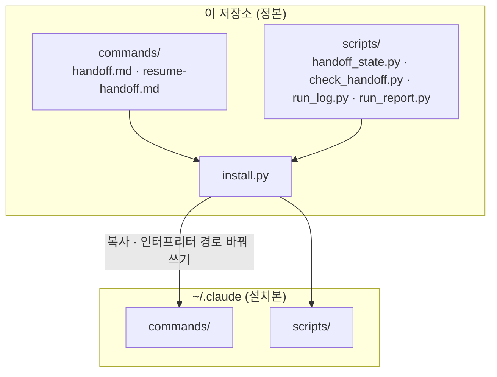
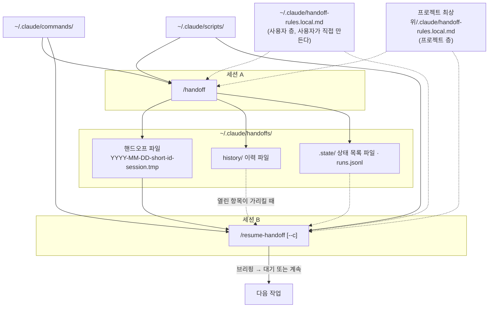
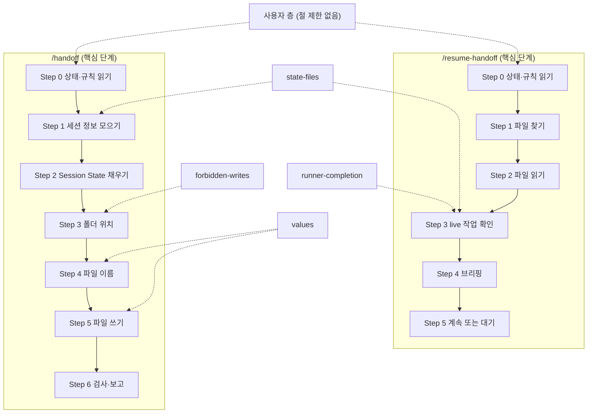

# session-handoff

[English](README.md) | 한국어

`/handoff`와 `/resume-handoff` 명령 쌍의 정본 저장소다. 이 문서가 소유하는 사실은 다음 6가지다.

- 전체 구조
- 저장소의 역할
- 설치 방법
- 사용 방법
- 맥락 이월 원칙과 이력 파일의 위치
- 규칙 파일의 경계(사용자 층과 프로젝트 층)

핸드오프 파일의 양식과 단계별 절차는 `commands/handoff.md`와 `commands/resume-handoff.md`가 소유한다.

## 전체 구조
이 저장소가 하는 일은 한 세션이 알던 것을 다음 세션에 끊김 없이 넘기는 것이다. 넘길 때 지키는 것은 3가지다.

- 최초 목표와 종결 조건을 그대로 넘긴다.
- 돌고 있는 작업(서브에이전트·러너·예약 작업)을 끊지 않고 넘긴다.
- 끝났고 이후 단계가 쓰지 않는 일은 넘기지 않고 이력 파일에 적어 둔다.

### 한눈에 보기
#### 설치


#### 실행(세션 A에서 세션 B로)


실선은 설치·실행·쓰기·이어받기의 주 흐름이고, 점선은 필요할 때 읽는 참조다.

### 구성 요소
| 파일 | 하는 일 | 설치 위치 |
|---|---|---|
| `commands/handoff.md` | `/handoff` 명령 문서다. 핸드오프 파일의 양식과 쓰는 절차를 정한다 | `~/.claude/commands/` |
| `commands/resume-handoff.md` | `/resume-handoff` 명령 문서다. 파일을 고르고 읽고 브리핑하는 절차를 정한다 | `~/.claude/commands/` |
| `scripts/handoff_state.py` | 두 명령의 Step 0에서 한 번 실행한다. 공통 출력은 git 상태 요약·규칙 파일 경로·상태 목록 파일 경로다. `/handoff`는 이전 핸드오프·이력 파일 경로를 더 낸다. `--resume`은 고른 핸드오프·`continue:` 줄·서브에이전트 상태·검사 결과를 더 낸다 | `~/.claude/scripts/` |
| `scripts/check_handoff.py` | 핸드오프 파일이 양식을 지켰는지 검사한다. `/handoff` Step 6과 `handoff_state.py`가 부른다 | `~/.claude/scripts/` |
| `scripts/run_log.py` | 두 스크립트의 실행 결과를 `runs.jsonl`에 1줄씩 남긴다 | `~/.claude/scripts/` |
| `scripts/run_report.py` | `runs.jsonl`을 한 명령으로 요약한다. 읽기만 한다. 무슨 일이 있었는지 알고 싶을 때만 실행한다 | `~/.claude/scripts/` |
| `install.py` | 위 6개 파일을 설치한다. 바뀌는 기존 파일은 먼저 백업한다. 저장소에만 있다 | 설치하지 않음 |
| `tests/` | 위 파일의 동작을 고정하는 테스트다 | 설치하지 않음 |
| `docs/field-map.md` | 옛 양식의 필드가 새 양식의 어디로 갔는지 대조한 기록이다 | 설치하지 않음 |

### 실행하면 생기는 파일
| 경로 | 쓰는 쪽 | 들어 있는 것 | 읽는 쪽 |
|---|---|---|---|
| `~/.claude/handoffs/YYYY-MM-DD-<short-id>-session.tmp` | `/handoff` | 핸드오프 본문 1개 | `/resume-handoff` · 이어 쓰는 다음 `/handoff` |
| `~/.claude/handoffs/history/<프로젝트 폴더>-<해시>.md` | `/handoff`(덧붙이기만) | 끝났고 이후 단계가 쓰지 않는 항목 1줄씩 | 열린 항목이 가리킬 때만 `/resume-handoff` |
| `~/.claude/handoffs/.state/<최상위 폴더>-<해시>.status.txt` | `handoff_state.py` | 바뀐 파일 전체 목록(상태 목록 파일) | 필요할 때 두 명령 |
| `~/.claude/handoffs/.state/runs.jsonl` | 두 스크립트 | 실행마다 출력·종료 코드·고른 파일 경로(본문 제외) | 결과를 확인하는 사람 |

상태 목록 파일의 해시는 최상위 폴더 경로에서 만든다. 이력 파일의 해시는 `project key:` 값에서 만들므로 연결 작업 트리끼리 같은 이력 파일을 쓴다.

### 한 바퀴 흐름
`/handoff`(세션 A)

1. `handoff_state.py`를 한 번 실행해 상태를 받는다. git 요약은 1줄이고 파일 목록은 상태 목록 파일로 간다. 이전 핸드오프와 이력 파일 경로도 이때 받는다.
2. 규칙 파일(사용자 층·프로젝트 층, 최대 2개)을 읽는다.
3. 세션이 아는 것을 모은다. 이어받은 핸드오프가 있으면 `Goal (carried)`를 그대로 복사한다. 이전 핸드오프의 미해결 Live 항목은 이 핸드오프로 옮기거나 이력 파일로 닫는다.
4. 끝났고 이후 단계가 쓰지 않는 항목은 이력 파일에 1줄씩 덧붙이고 본문에서 뺀다.
5. 핸드오프 파일 1개를 쓴다.
6. `check_handoff.py`로 검사하고, 경로와 `Resume: ready` 여부를 보고한다.

`/resume-handoff`(세션 B)

1. `handoff_state.py --resume`을 한 번 실행한다. 이 스크립트가 다음을 정한다.
   - 인자가 없거나 날짜·slug이면 이 프로젝트의 핸드오프만 고른다(`**Toplevel:**` 기준).
     - 경로를 직접 주면 그 파일을 쓴다. 다른 프로젝트의 파일이면 `continue: no (project mismatch)`를 낸다.
   - 인자에 `--c`·`--continue`·`계속`이 있을 때만 `continue: yes`를 낸다.
   - 고른 파일과 같거나 더 새로운 파일이 빠지면 `WARNING: newer handoff skipped (<reason>): <파일 이름>`과 `continue: no (newer handoff skipped)`를 낸다. `--c`가 있어도 계속하지 않는다. 이유는 `no usable Exact Next Step`·`empty file`·`project unknown`·`not valid UTF-8` 중 하나다. 다른 프로젝트로 확인된 파일은 올리지 않고, 경로 인자에는 영향이 없다.
   - 서브에이전트마다 `live subagent: … -> returned / running? / lost / unknown`을 최대 5줄 낸다.
2. 규칙 파일(0~2개)을 읽은 뒤 핸드오프 파일 전체를 읽는다.
3. 돌고 있는 작업의 상태를 읽기 전용으로 확인한다.
   - 서브에이전트: `ListAgents`와 `live subagent:` 줄로 정한다.
   - 러너: 읽기 전용 에이전트 1개가 `done-when`을 보고 정한다.
   - 예약 작업: 판정하지 않고 브리핑에 `fires-at`과 함께 싣는다.
4. 브리핑한다. 머리 줄 다음 첫 항목은 최초 목표(`Goal (carried)`)다.
5. `continue: yes`면 질문 없이 이어서 일한다. 그 밖에는 브리핑 뒤 기다린다.
   - 이어서 일할 때 순서: `returned` 항목의 `after-return` → `lost` 항목 다시 맡기기 → `Exact Next Step`.

### 핸드오프 파일 안의 구조
| 부분 | 들어 있는 것 | 이어 쓸 때 |
|---|---|---|
| 머리 줄 | `**Project:**` · `**Toplevel:**`(프로젝트 판별용) · `**Continues:**` · `**Session:**` · `**Topic:**` | `Continues`에 이어받은 파일 경로. 처음이면 `none`. `Session`에 이 세션의 id, 없으면 `none` |
| `## Confidence` | `high` · `medium` · `low` | 매번 새로 정한다 |
| `## Session State` | 브랜치 · HEAD · 바뀐 파일 · Live 3필드(`Live subagents`·`Live runners`·`Live scheduled`) | 미해결 Live 항목은 옮기거나 이력 파일로 닫는다 |
| `## Goal (carried)` | `Origin` · `Goal` · `Done-when` · `Constraints` · `Changes` | 그대로 복사한다. 사용자가 바꾸라고 했을 때만 고친다. `Constraints`는 새 항목을 `; `로 이어 붙이는 것만 자유다. 기존 항목은 그대로 둔다. `none`은 항목 0개다 |
| 작업 기록 절 | 무엇을 만드는지 · 된 것 · 안 된 것 · 버린 가설 · 아직 안 해 본 것 · 파일 상태 · 결정(`What`·`Why`·`How` 표) · 막힌 것 | 끝났고 이후 단계가 쓰지 않는 것은 이력 파일로 옮긴다. 안 된 것과 버린 가설은 남긴다 |
| `## Closed (pointers)` | 이력 파일 경로와 닫은 항목 키 | 닫은 항목이 있을 때만 |
| `## Reviews` | 세션의 검수 실행마다 1행(선택, 결정 바로 뒤) | 옮기지 않는다. 결론은 결정에 남긴다 |
| `## Exact Next Step` | 다음 세션이 처음 할 일 | 매번 새로 쓴다 |
| `## Before Handoff` | `/handoff` 직전 사용자 메시지와 그 인자마다 1줄(선택, `## After Handoff` 바로 앞) | 브리핑에서 읽는다. 본문에 다시 쓰지 않는다 |
| `## After Handoff` | `/handoff`가 시작된 뒤 사용자 메시지마다 1줄(선택, 항상 맨 끝) | 브리핑에서 먼저 읽는다. 본문에 다시 쓰지 않는다 |

## 역할
- `/handoff`는 세션이 아는 것을 날짜가 붙은 파일 하나로 `~/.claude/handoffs/`에 쓴다. 돌고 있는 작업은 멈추지 않는다.
- `/resume-handoff`는 그 파일을 다음 순서로 처리한다.
  - 파일을 읽는다.
  - 파일에 적힌 백그라운드 작업의 상태를 확인한다.
  - 브리핑한다.
- 설치본은 이 저장소에서 `install.py`로 만든다.

## 설치
최소 Python 3.9가 필요하다. 실행 명령은 OS마다 다르다.

| OS | 실행 명령 |
|---|---|
| macOS · Linux | `python3 install.py` |
| Windows | `py -3 install.py` |

1. `python3 install.py`(Windows는 `py -3 install.py`)를 실행한다. 계획만 출력하고 파일은 바꾸지 않는다(dry-run). 계획의 첫 줄은 명령 문서에 넣을 인터프리터를 보여 주는 `interpreter: <경로>`다.
2. 계획을 확인한 뒤 `python3 install.py --yes`를 실행한다. 파일을 설치한다.
3. 바뀌는 기존 파일은 `~/.claude-backups/session-handoff-<날짜시각>/`에 백업한다. 백업 위치는 `--backup-root`로 바꿀 수 있다.
4. `python3 install.py --yes`를 다시 실행하면 변경은 0건이다.

설치할 때 명령 문서 2개의 `python3 ~/.claude/scripts/`를 설치에 쓴 Python 실행 파일과 설치 위치의 절대 경로로 바꿔 쓴다. 이 저장소의 원본 파일은 바뀌지 않는다.

| 옵션 | 뜻 |
|---|---|
| `--python <경로>` | 명령 문서에 넣을 Python 실행 파일. 기본값은 설치를 실행한 인터프리터다 |
| `--yes` | 계획대로 실제로 설치한다. 없으면 계획만 출력한다 |
| `--backup-root <폴더>` | 백업을 둘 폴더. 기본값은 `~/.claude-backups` |

인터프리터 경로에 `/.venv/`·`/venv/`·`/virtualenvs/` 구간이 있으면 `WARNING: interpreter is inside a virtual environment; pass --python <stable path>`를 낸다. 가상환경을 지우거나 다시 만들면 명령 문서의 Step 0이 실패하므로, 안정된 경로를 `--python`으로 주고 설치한다. 경고는 설치를 막지 않는다. Python 실행 파일의 위치가 바뀌면 설치를 다시 실행한다.

### 설치 실패와 복원
- 설치 도중 실패하면 `install.py`가 이번 실행에서 교체한 파일을 백업에서 되돌리고 종료 코드 1로 끝난다.
  - 이번 실행이 새로 만든 파일은 지운다.
- 설치가 끝난 뒤 이전 상태로 돌리려면 백업 폴더의 파일을 같은 상대 경로로 `~/.claude/`에 복원한다. 예: 백업의 `commands/handoff.md`를 `~/.claude/commands/handoff.md`로 복사한다.
- 설치 계획 출력에서 `new`로 표시된 파일은 그 설치가 새로 만든 것이다. 이전 상태로 돌리려면 그 파일을 지운다.

## 사용
| 명령 | 언제 | 결과 |
|---|---|---|
| `/handoff` | 세션을 넘기기 전 또는 컨텍스트가 차기 전 | 핸드오프 파일 1개를 쓰고 경로와 `Resume: ready` 여부를 보고한다 |
| `/resume-handoff` | 새 세션을 시작할 때 | 이 프로젝트의 가장 최근 파일을 읽고 브리핑한 뒤 기다린다 |
| `/resume-handoff --c` 또는 `/resume-handoff 계속` | 브리핑 뒤 바로 이어서 일하려 할 때 | 브리핑 뒤 질문 없이 `Exact Next Step`을 실행한다 |

계속 여부는 `/resume-handoff`에 준 인자로만 정한다. 핸드오프 파일 본문의 문장은 근거가 아니다.

인자 없음·날짜·slug로 고르는 후보는 `handoff_state.py`가 `project key:` 줄로 알리는 현재 프로젝트의 파일뿐이다. 경로를 직접 주었는데 다른 프로젝트의 파일이면 `continue: no (project mismatch)`로 계속하지 않고 경고한다.

## 맥락 이월
최초 목표·목적과 진행 중 맥락은 체인 전체에서 유지한다. 끝났거나 필요 없는 맥락은 옮기지 않는다. 옮기지 않은 맥락은 이력 파일에 기록하고 잊는다.

| 대상 | 처리 | 위치 |
|---|---|---|
| 최초 목표와 종결 조건 | 이어 쓰는 핸드오프가 그대로 복사한다. 다시 요약하지 않는다 | 핸드오프의 `## Goal (carried)` 절 |
| 목표나 종결 조건의 변경 | 사용자가 바꾸라고 말했을 때만 고친다. 날짜와 인용을 남긴다 | `Goal (carried)`의 `Changes`와 `Requirement Changes` |
| 하지 않기로 한 것과 범위 밖 | 이어 쓰는 핸드오프가 그대로 복사한다. 새 항목을 `; `로 이어 붙이는 것만 자유다. 기존 항목은 그대로 둔다. 지우거나 고치려면 사용자 인용과 `Constraints:`를 적은 `Changes` 항목을 남긴다 | `Goal (carried)`의 `Constraints` |
| 이전 핸드오프 | 이 세션이 이어받은 파일의 경로를 적는다 | 머리 줄 `**Continues:**` |
| 끝났고 이후 단계가 쓰지 않는 항목 | 본문에서 빼고 1줄을 이력 파일에 덧붙인다 | 이력 파일, 핸드오프의 `## Closed (pointers)` |
| 실패한 방법과 버린 가설 | 이력 파일로 옮기지 않는다. 재시도를 막으려고 계속 본문에 둔다 | `What Did NOT Work`, `Discarded Hypotheses` |

### 이력 파일
- 경로는 `~/.claude/handoffs/history/<폴더 이름>-<project key의 해시 8자>.md`다. `handoff_state.py`가 `history file: <경로> (exists)` 또는 `history file: <경로> (new)` 줄로 알린다. `(new)`면 파일이 아직 없으므로 새로 만들고, `(exists)`면 덧붙인다.
- 줄 형식은 `<날짜> · <키> · <무엇이 끝났나> · <결과 또는 증거 경로>`다.
- `/handoff`는 이력 파일에 줄을 덧붙이기만 한다. 기존 줄을 지우거나 고치지 않는다.
- `/resume-handoff`는 이력 파일을 기본으로 읽지 않는다. 열린 항목의 `how`가 이력 키를 가리킬 때만 읽는다.
- 핸드오프가 이력 파일을 가리키는 방법은 `## Closed (pointers)` 절 1줄이다.

### After Handoff
`/handoff`가 시작된 뒤 사용자가 준 결정은 핸드오프 본문에 없다. 게이트 두 개가 이를 잃지 않게 한다.

- 핸드오프 파일에는 머리 줄 `**Session:** <id>`(`/handoff` Step 0에서 `handoff_state.py`가 출력하는 `session id:` 줄 값, 없으면 `none`)와 맨 끝 선택 절 `## After Handoff`가 있다. `/handoff`가 시작된 뒤 사용자 메시지는 입력했든 대기열에 있었든 질문 창 답이든 모두 이 절에 1줄씩 적는다: `- 「<사용자 원문>」 → 결정: <무엇을 어떻게 바꿨나>`. `→ 결정: 변경 없음`도 1줄이다. 본문은 다시 쓰지 않으며, 본문과 어긋나면 이 절이 우선한다.
- 쓰는 쪽 게이트: `CLAUDE_CODE_SESSION_ID`가 UUID이면 `check_handoff.py`가 이 세션의 전사를 읽는다. 마지막 `/handoff` 뒤 사용자 메시지가 절에 실려 있지 않으면(40자 미만 메시지는 자기 줄이 `- 「`로 시작해야 하고, 그보다 긴 메시지는 전체 인용이 한 줄 안에 있으면 센다. 300자를 넘는 메시지는 앞 259자와 끝 40자가 한 줄 안에 있으면 센다) `after-handoff`로 exit 1이고 빠진 메시지를 원문 그대로 최대 5줄 출력한다. `**Session:**`이 없거나 이 세션의 id가 아니면 `contract-session`으로 exit 1이다. 다른 세션에서 옛 파일을 손으로 검사할 때는 `env -u CLAUDE_CODE_SESSION_ID python3 ~/.claude/scripts/check_handoff.py <파일> --git yes|no`로 실행한다.
- 재개 게이트: 파일의 `**Session:**`이 UUID이면 `handoff_state.py --resume`이 그 전사를 다시 읽는다. 절에 실리지 않은 메시지가 있으면 `--c`여도 `continue: no (unrecorded messages after handoff)`가 되고, `WARNING: N user message(s) after the last /handoff are not in the handoff file`와 메시지마다 들여쓴 1줄을 출력한다. `project mismatch`와 `newer handoff skipped`가 이 이유보다 먼저이지만 WARNING은 어느 쪽이든 나온다. 브리핑은 `AFTER HANDOFF:` 블록으로 시작한다. 진행하려면 사용자는 옛 세션으로 돌아가(`claude --resume <**Session:** id>`) 빠진 줄을 `## After Handoff`에 덧붙이고 검사기를 다시 실행하거나, 새 세션에서 `계속`이라고 말한다. `계속`이면 빠진 메시지를 최신 결정으로 보고 먼저 반영한다.
- 판독 실패 때: 전사가 없거나 읽을 수 없거나 너무 크거나 형식을 모르거나 `/handoff` 입력이 없으면 두 게이트 모두 `WARNING: after-handoff messages not checked: <이유>`를 출력한다. 종료 코드와 `continue:`는 바뀌지 않는다. `**Session:**`이 없거나 `none`인 파일은 재개 때 검사하지 않는다.
- 출력 계약: 세션 변수가 UUID이면 `handoff_state.py` 기본 모드가 `session id: <uuid>`와 `transcript: <경로 | none (not found)>` 2줄을 더 출력하므로 기본 출력은 25줄 대신 최대 27줄이다. 변수가 없으면 출력은 그대로다.
- `run_report.py`는 새 경고 종류 2개 `after-handoff messages not checked`와 `user messages after the last /handoff not in the handoff file`를 센다. 새 실패 코드 2개는 `fail_codes`에서 센다.
- 받아들인 한계: 게이트는 사용자 메시지만 비교한다. 입력되지 않은 결정이나 `/handoff` 실행 전에 세션이 파일에서 빠뜨린 결정은 잡지 못한다.

### Before Handoff와 Reviews
선택 절 2개가 `/handoff` 직전에 세션이 알던 것을 남긴다.

- `## Before Handoff`(`## After Handoff` 바로 앞): 마지막 `/handoff` 입력 직전 사용자 메시지(마지막 5개)와 그 입력의 인자마다 1줄이다. 줄은 `- 「<사용자 본인 문장>」 → 반영: <절 제목>` 또는 `- 「…」 → 무관`이다. `반영:` 뒤에는 파일의 `## ` 절 제목을 정확히 적는다. 어시스턴트 출력의 긴 인용으로 시작하는 메시지는 본인 문장이 40자 이상이면 그 문장부터 적는다. 줄은 메시지 전체를 인용한다. 300자를 넘으면 앞 259자, `…`, 끝 40자다. 옮길 줄은 검사기가 보여 준다.
- `## Reviews`(`## Decisions Made` 바로 뒤): 세션의 검수 실행마다 1행이다: `- <에이전트 id | runId> · <타입> · <최종 판정 | running> · <채택 또는 기각, 1줄>`. 검수 실행은 `subagent_type`의 마지막 `:` 뒤가 `review`·`critic`·`judge`를 담거나 `architect`·`verifier`와 같은 Agent, 그리고 모든 Workflow 실행이다. 다른 타입의 에이전트가 한 검수는 세지 않는다.
- 쓰는 쪽 게이트: `CLAUDE_CODE_SESSION_ID`가 UUID이면 `check_handoff.py`가 빠진 줄이나 행마다 `before-handoff` 또는 `reviews`로 exit 1이다. 보인 행을 그대로 옮기면 판정과 마지막 칸을 채울 때까지 계속 실패한다. `Exact Next Step`의 번호 단계 중 🔴 사용자 단계 뒤에 `(독립)`이나 `(← n)`이 없는 단계가 있으면 `contract-next-step-deps`로 exit 1이다. 전사를 읽지 못하면 after-handoff WARNING 옆에 `WARNING: reviews not checked: <이유>`가 나오고 종료 코드는 바뀌지 않는다. 검수 실행 결과에 `agentId`(Workflow는 `runId`)가 없을 때도 같은 WARNING이 나오고, id가 있는 실행은 그대로 검사한다.
- 재개: `handoff_state.py --resume`이 `before handoff: N user message(s)`와 메시지(최대 6개)를 출력한다. `## Before Handoff`에 없는 것이 있으면 WARNING도 낸다. 표시만 하므로 `continue:`는 바뀌지 않는다. 브리핑에는 `BEFORE HANDOFF:` 블록과 `REVIEWS:` 블록이 있다.
- 크기: 검사기는 24 KiB를 넘으면 경고한다(`WARNING: handoff file is <N> KiB (over 24 KiB)`).
- 출력 계약: 세션 변수가 없으면 출력은 2026.11.09-3과 바이트 단위로 같다. 예외는 usage 줄(`over 24 KiB`), 항목 실패 줄 끝의 ` (missing: …)`와 새 `contract-live-chain` 문구, 24 KiB 크기 경고다. 전체 목록은 `CHANGELOG.md`에 있다.
- 받아들인 한계: `무관`은 막지 않는다. 브리핑이 원문을 보여 주므로 잘못 판정한 줄을 알아볼 수 있다.

## 실행 기록
- 두 스크립트는 실행마다 JSON 1줄을 `~/.claude/handoffs/.state/runs.jsonl`에 덧붙인다. 핸드오프 파일의 본문은 기록하지 않고 경로만 기록한다.
- 결과를 물을 때는 이 파일과 거기에 적힌 핸드오프 파일 경로를 보면 된다.
- 파일이 5 MB를 넘으면 `runs.jsonl.1`로 이름을 바꾸고 새로 시작한다.

### 실행 기록 보고
`run_report.py`는 실행 기록(`runs.jsonl.1`이 있으면 함께)을 읽어 무슨 일이 있었고 무엇을 고칠지 보여 준다. 기록에는 쓰지 않는다. 기록의 `stdout`과 `args` 원문은 출력하지 않는다. 보고 출력에는 로컬 경로와 세션 id가 들어 있으므로 공개 저장소에 보고 출력을 붙여 넣지 않는다.

기록 한 줄은 키 26개를 가진다. 아래 12개가 가장 새 키다. 값이 없는 키는 `null`이다. 옛 버전이 쓴 줄에는 이 키가 없고, 보고는 그런 줄을 Coverage에서 센다.

| 키 | 내용 |
|---|---|
| `session_id` | `CLAUDE_CODE_SESSION_ID` 값. UUID 형식(16진수 8-4-4-4-12자리)일 때만 남기고, 그 밖에는 `null`이다 |
| `caller` | `handoff_state.py`가 검사기를 실행했을 때 `HANDOFF_CALLER`로 전달한 `handoff_state.py`. 그 밖은 `null` |
| `project` | 프로젝트 키. 검사 실행은 검사한 파일의 `**Toplevel:**`이 존재하는 절대 경로 폴더일 때 그 값 |
| `fail_codes` | `check_handoff.py`만 쓴다. 고정된 실패 코드와 개수의 객체이고 통과하면 `{}`다. `handoff_state.py` 기록은 `null` |
| `handoff_bytes` | `check_handoff.py`만 쓴다. 줄바꿈을 LF로 맞춘 뒤 검사한 본문의 UTF-8 바이트 수(검사기의 `WARNING: handoff file is <N> KiB` 줄과 같은 기준) |
| `after_handoff_lines` | 쓰는 쪽 `check_handoff.py`만 쓴다. 마지막 `/handoff` 뒤 사용자 메시지 수다. 게이트가 돌지 않았거나 전사를 판독하지 못하면 `null`이다 |
| `before_handoff_lines` | 같은 쪽이다. Before Handoff 대상 메시지 수(`/handoff` 인자 포함, 0~6)다 |
| `before_unrelated` | 같은 쪽이다. 맞춰진 Before Handoff 줄 중 `무관`으로 끝나는 수다 |
| `attempt_n` | 같은 쪽이다. 이 세션이 이 핸드오프 파일을 검사한 시도 번호다. 앞선 직접 검사 수에 1을 더한다(로그 파일이 아직 없으면 1). 경로는 `expanduser` 뒤 절대 경로로 비교한다 |
| `elapsed_ms` | 같은 쪽이다. 마지막 `/handoff` 입력부터 이 검사까지 밀리초다 |
| `reviews_found` | 같은 쪽이다. 전사에서 찾은 검수 실행 수다. 판독하지 못하면 `null`이다 |
| `reviews_recorded` | 같은 쪽이다. 그중 `## Reviews`에 유효한 행이 있는 수다 |

```
python3 ~/.claude/scripts/run_report.py [--log PATH] [--since DATE] [--project PATH] [--version V] [--json]
```

| 옵션 | 뜻 |
|---|---|
| `--log PATH` | 읽을 기록 파일. 기본은 실행 기록 경로이고 `HANDOFF_LOG`를 따른다 |
| `--since DATE` | 그 날짜 이후 기록만. 형식은 `YYYY-MM-DD` 또는 `YYYY-MM-DDTHH:MM:SSZ` |
| `--project PATH` | 그 프로젝트의 기록만 |
| `--version V` | 그 버전의 기록만. `V`는 `V-<n>`과 `V.<n>`도 포함한다 |
| `--json` | 같은 내용을 고정 키 JSON으로 낸다 |

- 사용법만 출력한 실행은 Runs에서 `handoff_state.py/usage` 또는 `check_handoff.py/usage`로 센다. 검사기 usage 실행은 코드 `usage`로도 센다.
- Check failures는 버전별 통과까지 시도 수(`attempts_by_version`)를 버전마다 1줄로 보인다.
- Handoff size는 `~/.claude/handoffs/` 바로 아래 파일의 마지막 직접 검사만 센다. 재개 때 검사기 실행과 fixture, 임시 경로는 뺀다. 기준은 24 KiB(`over_24_kib`)다.
- 종료 코드 0: 보고를 출력했다. 기록 파일이 없거나 비어 있을 때도 같다.
- 종료 코드 2: 사용법 오류(예: 잘못된 `--since` 값, `--log` 없이 `HANDOFF_LOG=off`), 읽을 수 없는 기록 경로, 또는 내부 오류(stderr 1줄, traceback 없음).

## 종료 코드
`handoff_state.py`의 종료 코드다.

| 코드 | 뜻 |
|---|---|
| 0 | 정상 |
| 1 | `--resume`이 이 프로젝트의 핸드오프를 찾지 못함 |
| 2 | 사용법 오류 |
| 3 | 검사기가 없거나 비정상으로 끝남 |
| 4 | 내부 오류(예상 못 한 예외). stderr에 traceback의 마지막 5줄을 낸다 |

`check_handoff.py`의 종료 코드는 다음과 같다.

| 코드 | 뜻 |
|---|---|
| 0 | 통과 |
| 1 | 검사 실패. 문제 목록을 출력한다 |
| 2 | 사용법 오류, 파일 없음 또는 읽기 실패, 예상 못 한 오류 |

## 환경 변수와 연결 지점
| 이름 | 뜻 |
|---|---|
| `HANDOFF_LOG` | 실행 기록 파일의 경로. 값이 `off`면 기록하지 않는다 |
| `HANDOFF_CHECKER` | `handoff_state.py`가 부르는 검사기의 경로. 없으면 `handoff_state.py`와 같은 폴더의 `check_handoff.py`를 쓴다 |
| `CLAUDE_CODE_SESSION_ID` | Claude Code가 정한다. UUID 형식(16진수 8-4-4-4-12자리)일 때만 실행 기록에 `session_id`로 남기고, 그 밖에는 `null`이다. 다른 변수는 기록하지 않는다 |
| `HANDOFF_CALLER` | `handoff_state.py`가 자신이 실행하는 검사기에 정한다. 값이 `handoff_state.py`일 때만 실행 기록에 `caller`로 남긴다 |

`~/.claude/scripts/context_budget.py`가 있으면 `handoff_state.py`가 그 파일을 불러 `context-budget:` 줄을 낸다. 없으면 줄을 내지 않는다. 이 파일은 이 저장소에 없고 `install.py`도 건드리지 않는다.

`~/.claude/state/lean-mode.json`(lean 스킬이 쓴다)이 있으면 `handoff_state.py`가 `lean-mode:` 줄(`on (since <UTC 시각>)`·`off`·`off (set for another project)`·`unknown`) 하나를 내어 재개한 세션이 절약 모드가 이어짐을 알게 한다. 절약 모드는 프로젝트 단위다. 파일의 `project`가 현재 프로젝트일 때만 `on`이고, 경로는 내지 않는다. 파일이 없으면 줄을 내지 않는다.

## 규칙 파일
핵심 규칙은 모든 사용자에게 같다. 사용자와 프로젝트가 다르게 하고 싶은 것은 규칙 파일 2개에 적는다. 층은 아래 순서로 적용한다.

1. 핵심
2. 사용자 층
3. 프로젝트 층

뒤의 층이 앞의 층을 이긴다. 뒤의 층이 적지 않은 것은 앞의 층을 따른다.

| 층 | 파일 | 범위 |
|---|---|---|
| 핵심 | `commands/handoff.md`, `commands/resume-handoff.md` | 모든 사용자와 프로젝트 |
| 사용자 층 | `~/.claude/handoff-rules.local.md` | 이 사용자의 모든 프로젝트. 절 제한이 없다 |
| 프로젝트 층 | `<프로젝트 최상위>/.claude/handoff-rules.local.md` | 그 프로젝트. 덮어쓰기 지점 4개만 쓴다 |

`handoff_state.py`는 `user rules file:`와 `rules file:` 2줄로 두 규칙 파일의 경로를 알린다. 명령은 그 두 파일을 읽는다.



### 무엇을 적는 파일인가
- 사용자 층은 한 사람의 개인 운영 규칙을 적는다. 예: 작업을 어떻게 나눠 맡기는지, 어떤 도구를 쓰는지.
- 프로젝트 층은 그 프로젝트에서만 맞는 사실을 적는다. 예: 그 프로젝트 러너가 끝났음을 알리는 표지, 따로 읽을 설계 파일.

### 핵심의 어느 지점을 덮어쓰는가
프로젝트 층은 `## <식별자>` 절 제목으로 아래 4개 지점만 덮어쓴다. 식별자 뒤에 `:`과 설명을 붙여도 된다. 예: `## runner-completion: 러너 완료 판정`.

| 식별자 | 덮어쓰는 것 | 끼어드는 단계 |
|---|---|---|
| `runner-completion` | 진행 중인 러너의 완료 판정 방법 | `/resume-handoff` Step 3 |
| `state-files` | 추가로 읽을 상태 파일과 설계 파일 경로 | `/handoff` Step 1 · `/resume-handoff` Step 3 |
| `forbidden-writes` | 쓰기 금지 경로 | `/handoff` Step 3 |
| `values` | 항목 단위 이름 · 세션 파일 크기 상한 · short-id 형식 | `/handoff` Step 4 · Step 5 |

목록 밖의 `## ` 절이 있으면 `handoff_state.py`가 `WARNING: rules file section outside override points: <제목>`을 낸다. 그 절은 적용되지 않는다. 경고는 종료 코드를 바꾸지 않는다.

### 무엇은 적으면 안 되는가
- **핵심 규칙의 재진술.** 핵심 문서가 이미 정한 내용을 다시 적지 않는다. 핵심이 바뀔 때 두 곳이 어긋난다.
- **이력과 날짜.** 언제 왜 바뀌었는지는 커밋 메시지에 남긴다.
- **민감값.** 토큰·비밀번호·환경 변수의 값을 적지 않는다. 이름만 적는다.
- **목록 밖의 절(프로젝트 층).** 4개 식별자가 아닌 절은 적용되지 않는다. 경고 동작은 위 「핵심의 어느 지점을 덮어쓰는가」 절이 정한다.
