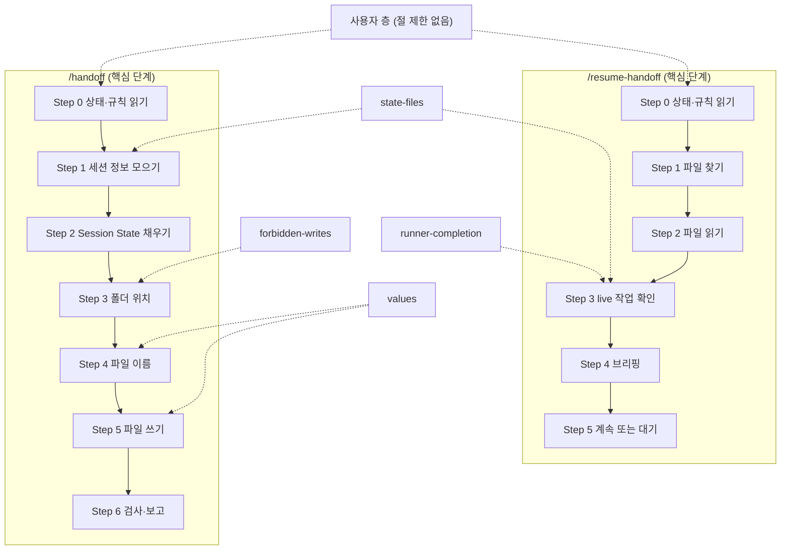

# session-handoff

`/handoff`와 `/resume-handoff` 명령 쌍의 정본 저장소다. 이 문서가 소유하는 사실은 다음 5가지다.

- 저장소의 역할
- 설치 방법
- 사용 방법
- 맥락 이월 원칙과 이력 파일의 위치
- 규칙 파일의 경계(사용자 층과 프로젝트 층)

핸드오프 파일의 양식과 단계별 절차는 `commands/handoff.md`와 `commands/resume-handoff.md`가 소유한다.

## 역할
- `/handoff`는 세션이 아는 것을 날짜가 붙은 파일 하나로 `~/.claude/handoffs/`에 쓴다. 돌고 있는 작업은 멈추지 않는다.
- `/resume-handoff`는 그 파일을 다음 순서로 처리한다.
  - 파일을 읽는다.
  - 파일에 적힌 백그라운드 작업의 상태를 확인한다.
  - 브리핑한다.
- 설치본은 이 저장소에서 `install.py`로 만든다.

## 설치
최소 Python 3.9가 필요하다. 실행 명령은 OS마다 다르다.

| OS | 실행 명령 |
|---|---|
| macOS · Linux | `python3 install.py` |
| Windows | `py -3 install.py` |

1. `python3 install.py`(Windows는 `py -3 install.py`)를 실행한다. 계획만 출력하고 파일은 바꾸지 않는다(dry-run). 계획의 첫 줄은 명령 문서에 넣을 인터프리터를 보여 주는 `interpreter: <경로>`다.
2. 계획을 확인한 뒤 `python3 install.py --yes`를 실행한다. 파일을 설치한다.
3. 바뀌는 기존 파일은 `~/.claude-backups/session-handoff-<날짜시각>/`에 백업한다. 백업 위치는 `--backup-root`로 바꿀 수 있다.
4. `python3 install.py --yes`를 다시 실행하면 변경은 0건이다.

설치할 때 명령 문서 2개의 `python3 ~/.claude/scripts/`를 설치에 쓴 Python 실행 파일과 설치 위치의 절대 경로로 바꿔 쓴다. 이 저장소의 원본 파일은 바뀌지 않는다.

| 옵션 | 뜻 |
|---|---|
| `--python <경로>` | 명령 문서에 넣을 Python 실행 파일. 기본값은 설치를 실행한 인터프리터다 |
| `--yes` | 계획대로 실제로 설치한다. 없으면 계획만 출력한다 |
| `--backup-root <폴더>` | 백업을 둘 폴더. 기본값은 `~/.claude-backups` |

인터프리터 경로에 `/.venv/`·`/venv/`·`/virtualenvs/` 구간이 있으면 `WARNING: interpreter is inside a virtual environment; pass --python <stable path>`를 낸다. 가상환경을 지우거나 다시 만들면 명령 문서의 Step 0이 실패하므로, 안정된 경로를 `--python`으로 주고 설치한다. 경고는 설치를 막지 않는다. Python 실행 파일의 위치가 바뀌면 설치를 다시 실행한다.

### 설치 실패와 복원
- 설치 도중 실패하면 `install.py`가 이번 실행에서 교체한 파일을 백업에서 되돌리고 종료 코드 1로 끝난다.
  - 이번 실행이 새로 만든 파일은 지운다.
- 설치가 끝난 뒤 이전 상태로 돌리려면 백업 폴더의 파일을 같은 상대 경로로 `~/.claude/`에 복원한다. 예: 백업의 `commands/handoff.md`를 `~/.claude/commands/handoff.md`로 복사한다.
- 설치 계획 출력에서 `new`로 표시된 파일은 그 설치가 새로 만든 것이다. 이전 상태로 돌리려면 그 파일을 지운다.

## 사용
| 명령 | 언제 | 결과 |
|---|---|---|
| `/handoff` | 세션을 넘기기 전 또는 컨텍스트가 차기 전 | 핸드오프 파일 1개를 쓰고 경로와 `Resume: ready` 여부를 보고한다 |
| `/resume-handoff` | 새 세션을 시작할 때 | 이 프로젝트의 가장 최근 파일을 읽고 브리핑한 뒤 기다린다 |
| `/resume-handoff --c` 또는 `/resume-handoff 계속` | 브리핑 뒤 바로 이어서 일하려 할 때 | 브리핑 뒤 질문 없이 `Exact Next Step`을 실행한다 |

계속 여부는 `/resume-handoff`에 준 인자로만 정한다. 핸드오프 파일 본문의 문장은 근거가 아니다.

인자 없음·날짜·slug로 고르는 후보는 `handoff_state.py`가 `project key:` 줄로 알리는 현재 프로젝트의 파일뿐이다. 경로를 직접 주었는데 다른 프로젝트의 파일이면 `continue: no (project mismatch)`로 계속하지 않고 경고한다.

## 맥락 이월
최초 목표·목적과 진행 중 맥락은 체인 전체에서 유지한다. 끝났거나 필요 없는 맥락은 옮기지 않는다. 옮기지 않은 맥락은 이력 파일에 기록하고 잊는다.

| 대상 | 처리 | 위치 |
|---|---|---|
| 최초 목표와 종결 조건 | 이어 쓰는 핸드오프가 그대로 복사한다. 다시 요약하지 않는다 | 핸드오프의 `## Goal (carried)` 절 |
| 목표나 종결 조건의 변경 | 사용자가 바꾸라고 말했을 때만 고친다. 날짜와 인용을 남긴다 | `Goal (carried)`의 `Changes`와 `Requirement Changes` |
| 이전 핸드오프 | 이 세션이 이어받은 파일의 경로를 적는다 | 머리 줄 `**Continues:**` |
| 끝났고 이후 단계가 쓰지 않는 항목 | 본문에서 빼고 1줄을 이력 파일에 덧붙인다 | 이력 파일, 핸드오프의 `## Closed (pointers)` |
| 실패한 방법과 버린 가설 | 이력 파일로 옮기지 않는다. 재시도를 막으려고 계속 본문에 둔다 | `What Did NOT Work`, `Discarded Hypotheses` |

### 이력 파일
- 경로는 `~/.claude/handoffs/history/<폴더 이름>-<project key의 해시 8자>.md`다. `handoff_state.py`가 `history file: <경로> (exists)` 또는 `history file: <경로> (new)` 줄로 알린다. `(new)`면 파일이 아직 없으므로 새로 만들고, `(exists)`면 덧붙인다.
- 줄 형식은 `<날짜> · <키> · <무엇이 끝났나> · <결과 또는 증거 경로>`다.
- `/handoff`는 이력 파일에 줄을 덧붙이기만 한다. 기존 줄을 지우거나 고치지 않는다.
- `/resume-handoff`는 이력 파일을 기본으로 읽지 않는다. 열린 항목의 `how`가 이력 키를 가리킬 때만 읽는다.
- 핸드오프가 이력 파일을 가리키는 방법은 `## Closed (pointers)` 절 1줄이다.

## 실행 기록
- 두 스크립트는 실행마다 JSON 1줄을 `~/.claude/handoffs/.state/runs.jsonl`에 덧붙인다. 핸드오프 파일의 본문은 기록하지 않고 경로만 기록한다.
- 결과를 물을 때는 이 파일과 거기에 적힌 핸드오프 파일 경로를 보면 된다.
- 파일이 5 MB를 넘으면 `runs.jsonl.1`로 이름을 바꾸고 새로 시작한다.

## 종료 코드
`handoff_state.py`의 종료 코드다.

| 코드 | 뜻 |
|---|---|
| 0 | 정상 |
| 1 | `--resume`이 이 프로젝트의 핸드오프를 찾지 못함 |
| 2 | 사용법 오류 |
| 3 | 검사기가 없거나 비정상으로 끝남 |
| 4 | 내부 오류(예상 못 한 예외). stderr에 traceback의 마지막 5줄을 낸다 |

`check_handoff.py`의 종료 코드는 다음과 같다.

| 코드 | 뜻 |
|---|---|
| 0 | 통과 |
| 1 | 검사 실패. 문제 목록을 출력한다 |
| 2 | 사용법 오류, 파일 없음 또는 읽기 실패, 예상 못 한 오류 |

## 환경 변수와 연결 지점
| 이름 | 뜻 |
|---|---|
| `HANDOFF_LOG` | 실행 기록 파일의 경로. 값이 `off`면 기록하지 않는다 |
| `HANDOFF_CHECKER` | `handoff_state.py`가 부르는 검사기의 경로. 없으면 `handoff_state.py`와 같은 폴더의 `check_handoff.py`를 쓴다 |

`~/.claude/scripts/context_budget.py`가 있으면 `handoff_state.py`가 그 파일을 불러 `context-budget:` 줄을 낸다. 없으면 줄을 내지 않는다. 이 파일은 이 저장소에 없고 `install.py`도 건드리지 않는다.

## 규칙 파일
핵심 규칙은 모든 사용자에게 같다. 사용자와 프로젝트가 다르게 하고 싶은 것은 규칙 파일 2개에 적는다. 층은 아래 순서로 적용한다.

1. 핵심
2. 사용자 층
3. 프로젝트 층

뒤의 층이 앞의 층을 이긴다. 뒤의 층이 적지 않은 것은 앞의 층을 따른다.

| 층 | 파일 | 범위 |
|---|---|---|
| 핵심 | `commands/handoff.md`, `commands/resume-handoff.md` | 모든 사용자와 프로젝트 |
| 사용자 층 | `~/.claude/handoff-rules.local.md` | 이 사용자의 모든 프로젝트. 절 제한이 없다 |
| 프로젝트 층 | `<프로젝트 최상위>/.claude/handoff-rules.local.md` | 그 프로젝트. 덮어쓰기 지점 4개만 쓴다 |

`handoff_state.py`는 `user rules file:`와 `rules file:` 2줄로 두 규칙 파일의 경로를 알린다. 명령은 그 두 파일을 읽는다.

### 무엇을 적는 파일인가
- 사용자 층은 한 사람의 개인 운영 규칙을 적는다. 예: 작업을 어떻게 나눠 맡기는지, 어떤 도구를 쓰는지.
- 프로젝트 층은 그 프로젝트에서만 맞는 사실을 적는다. 예: 그 프로젝트 러너가 끝났음을 알리는 표지, 따로 읽을 설계 파일.

### 핵심의 어느 지점을 덮어쓰는가
프로젝트 층은 `## <식별자>` 절 제목으로 아래 4개 지점만 덮어쓴다. 식별자 뒤에 `:`과 설명을 붙여도 된다. 예: `## runner-completion: 러너 완료 판정`.

| 식별자 | 덮어쓰는 것 | 끼어드는 단계 |
|---|---|---|
| `runner-completion` | 진행 중인 러너의 완료 판정 방법 | `/resume-handoff` Step 3 |
| `state-files` | 추가로 읽을 상태 파일과 설계 파일 경로 | `/handoff` Step 1 · `/resume-handoff` Step 3 |
| `forbidden-writes` | 쓰기 금지 경로 | `/handoff` Step 3 |
| `values` | 항목 단위 이름 · 세션 파일 크기 상한 · short-id 형식 | `/handoff` Step 4 · Step 5 |

목록 밖의 `## ` 절이 있으면 `handoff_state.py`가 `WARNING: rules file section outside override points: <제목>`을 낸다. 그 절은 적용되지 않는다. 경고는 종료 코드를 바꾸지 않는다.

### 무엇은 적으면 안 되는가
- **핵심 규칙의 재진술.** 핵심 문서가 이미 정한 내용을 다시 적지 않는다. 핵심이 바뀔 때 두 곳이 어긋난다.
- **이력과 날짜.** 언제 왜 바뀌었는지는 커밋 메시지에 남긴다.
- **민감값.** 토큰·비밀번호·환경 변수의 값을 적지 않는다. 이름만 적는다.
- **목록 밖의 절(프로젝트 층).** 4개 식별자가 아닌 절은 적용되지 않는다. 경고 동작은 위 「핵심의 어느 지점을 덮어쓰는가」 절이 정한다.
