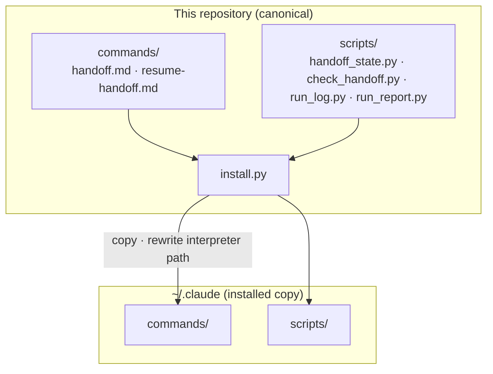
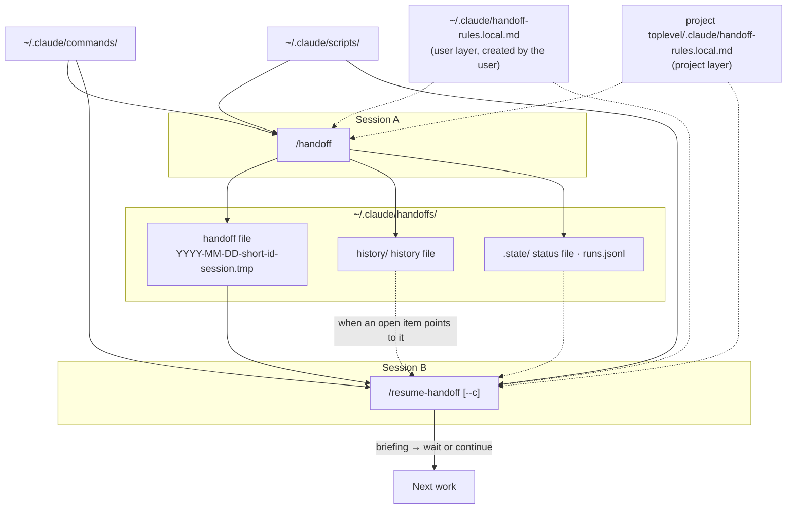
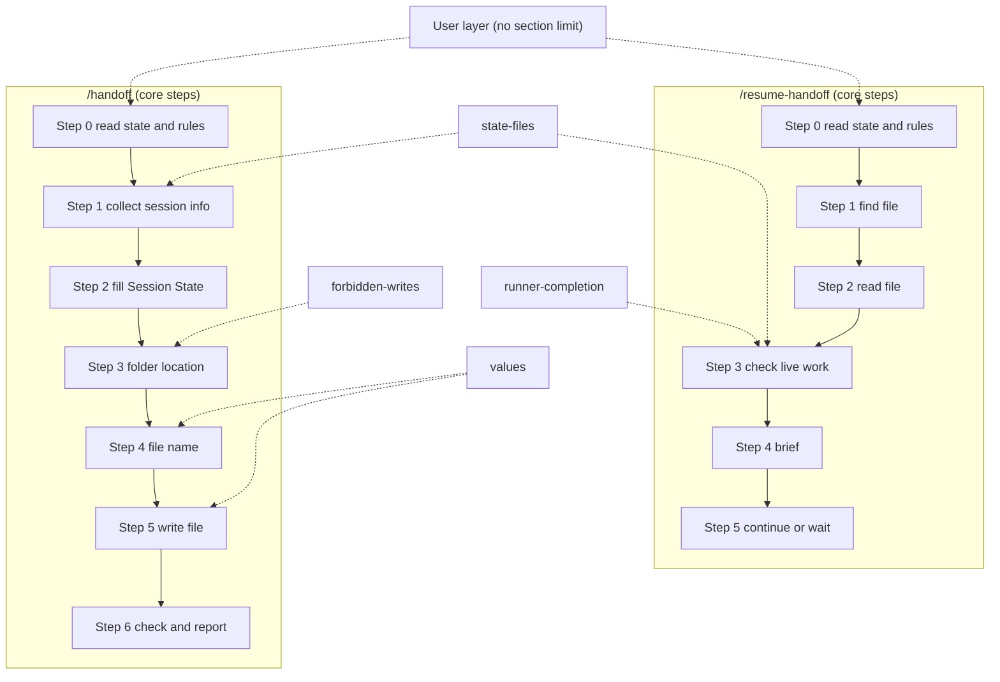

# session-handoff

English | [한국어](README.ko.md)

This is the canonical repository for the `/handoff` and `/resume-handoff` command pair. This document owns six facts:

- the overall structure
- the role of the repository
- how to install
- how to use
- the context carry-over principle and where the history file lives
- the boundary between the rules files (user layer and project layer)

The format of the handoff file and the step-by-step procedures are owned by `commands/handoff.md` and `commands/resume-handoff.md`.

## Overall Structure
This repository passes what one session knew to the next session without a break. Three things are kept when passing it on:

- The original goal and its done-when condition are passed on as they are.
- Work that is still running (subagents, runners, scheduled jobs) is passed on without being stopped.
- Work that has ended and that later steps do not use is not passed on. It is written to the history file instead.

### At a Glance
#### Install


#### Run (session A to session B)


Solid lines are the main flow of install, run, write, and resume. Dotted lines are references read when needed.

### Components
| File | What it does | Installed to |
|---|---|---|
| `commands/handoff.md` | The `/handoff` command document. It sets the format of the handoff file and the steps to write it | `~/.claude/commands/` |
| `commands/resume-handoff.md` | The `/resume-handoff` command document. It sets the steps to pick, read, and brief a handoff file | `~/.claude/commands/` |
| `scripts/handoff_state.py` | Run once in Step 0 of both commands. Common output: a git state summary, the rules file paths, and the status file path. `/handoff` also prints the previous handoff and history file paths. `--resume` also prints the chosen handoff, the `continue:` line, subagent states, and the check result | `~/.claude/scripts/` |
| `scripts/check_handoff.py` | Checks that a handoff file follows the format. `/handoff` Step 6 and `handoff_state.py` call it | `~/.claude/scripts/` |
| `scripts/run_log.py` | Writes one line per run of the two scripts to `runs.jsonl` | `~/.claude/scripts/` |
| `scripts/run_report.py` | Summarizes `runs.jsonl` in one command, read-only. Run it only when you want to know what happened | `~/.claude/scripts/` |
| `install.py` | Installs the six files above. Existing files that would change are backed up first. It exists only in this repository | Not installed |
| `tests/` | Tests that pin the behavior of the files above | Not installed |
| `docs/field-map.md` | A record of where each field of the old format went in the new format | Not installed |

### Files Created at Run Time
| Path | Written by | Contents | Read by |
|---|---|---|---|
| `~/.claude/handoffs/YYYY-MM-DD-<short-id>-session.tmp` | `/handoff` | One handoff body | `/resume-handoff` · the next `/handoff` that continues it |
| `~/.claude/handoffs/history/<project folder>-<hash>.md` | `/handoff` (append only) | One line per item that has ended and that later steps do not use | `/resume-handoff`, only when an open item points to it |
| `~/.claude/handoffs/.state/<top-level folder>-<hash>.status.txt` | `handoff_state.py` | The full list of changed files (the status file) | Both commands, when needed |
| `~/.claude/handoffs/.state/runs.jsonl` | Both scripts | Per run: output, exit code, and chosen file path (no body) | The person checking results |

The hash of the status file is made from the top-level folder path. The hash of the history file is made from the `project key:` value, so linked worktrees share one history file.

### One Round Trip
`/handoff` (session A)

1. Run `handoff_state.py` once to get the state. The git summary is one line, and the file list goes to the status file. The previous handoff and history file paths also arrive here.
2. Read the rules files (user layer and project layer, at most 2).
3. Collect what the session knows. If there is a handoff being continued, copy its `Goal (carried)` exactly. Move each unresolved Live item of the previous handoff into this handoff, or close it in the history file.
4. Append one line per ended item that later steps do not use to the history file, and remove it from the body.
5. Write one handoff file.
6. Check it with `check_handoff.py`, and report the path and whether it is `Resume: ready`.

`/resume-handoff` (session B)

1. Run `handoff_state.py --resume` once. The script decides the following.
   - With no argument, or with a date or slug, it picks only this project's handoffs (by `**Toplevel:**`).
     - If a path is given, that file is used. If it belongs to another project, the script prints `continue: no (project mismatch)`.
   - It prints `continue: yes` only when the argument has `--c`, `--continue`, or `계속` (“continue” in Korean).
   - If a file that is as new as or newer than the chosen one is dropped, it prints `WARNING: newer handoff skipped (<reason>): <file name>` and `continue: no (newer handoff skipped)`. Work does not continue even with `--c`. The reason is `no usable Exact Next Step`, `empty file`, `project unknown`, or `not valid UTF-8`. A file confirmed to belong to another project is not listed, and a path argument is not affected.
   - For each subagent it prints `live subagent: … -> returned / running? / lost / unknown`, at most 5 lines.
2. Read the rules files (0 to 2), then read the whole handoff file.
3. Check the state of running work, read-only.
   - Subagents: decided from `ListAgents` and the `live subagent:` lines.
   - Runners: one read-only agent decides from `done-when`.
   - Scheduled jobs: not judged. The briefing lists them with `fires-at`.
4. Brief. The first item after the header line is the original goal (`Goal (carried)`).
5. If `continue: yes`, keep working without asking. Otherwise, wait after the briefing.
   - Order when continuing: `after-return` of `returned` items, then re-dispatch of `lost` items, then `Exact Next Step`.

### Structure of a Handoff File
| Part | Contents | When continuing |
|---|---|---|
| Header lines | `**Project:**` · `**Toplevel:**` (identifies the project) · `**Continues:**` · `**Topic:**` | `Continues` holds the path of the file being continued. `none` for the first one |
| `## Confidence` | `high` · `medium` · `low` | Decided anew each time |
| `## Session State` | Branch · HEAD · changed files · three Live fields (`Live subagents` · `Live runners` · `Live scheduled`) | Move each unresolved Live item, or close it in the history file |
| `## Goal (carried)` | `Origin` · `Goal` · `Done-when` · `Constraints` · `Changes` | Copy as is. Change it only when the user says to. Only adding new items to the end of `Constraints`, separated by `; `, is free. Existing items stay as they are. `none` means zero items |
| Work record sections | What we are building · what worked · what did not work · discarded hypotheses · what has not been tried · state of files · decisions (`What` · `Why` · `How` table) · blockers | Move what has ended and what later steps do not use to the history file. Keep what did not work and the discarded hypotheses |
| `## Closed (pointers)` | The history file path and the keys of the closed items | Only when there are closed items |
| `## Exact Next Step` | What the next session does first | Written anew each time |

## Roles
- `/handoff` writes what the session knows into one dated file in `~/.claude/handoffs/`. It does not stop running work.
- `/resume-handoff` processes that file in this order:
  - Read the file.
  - Check the state of the background work the file lists.
  - Brief.
- The installed copy is made from this repository by `install.py`.

## Install
Python 3.9 or later is required. The command differs by OS.

| OS | Command |
|---|---|
| macOS · Linux | `python3 install.py` |
| Windows | `py -3 install.py` |

1. Run `python3 install.py` (on Windows, `py -3 install.py`). It prints the plan only and changes no file (dry-run). The first line of the plan is `interpreter: <path>`, which shows the interpreter that goes into the command documents.
2. After checking the plan, run `python3 install.py --yes`. It installs the files.
3. Existing files that would change are backed up to `~/.claude-backups/session-handoff-<YYYYMMDD-HHMMSS>/`. `--backup-root` changes the backup location.
4. Running `python3 install.py --yes` again makes 0 changes.

At install time, `python3 ~/.claude/scripts/` in the two command documents is rewritten to the Python executable used for the install and the absolute install path. The original files in this repository are not changed.

| Option | Meaning |
|---|---|
| `--python <path>` | The Python executable to write into the command documents. The default is the interpreter that ran the install |
| `--yes` | Install for real, as planned. Without it, only the plan is printed |
| `--backup-root <folder>` | The folder that holds backups. The default is `~/.claude-backups` |

If the interpreter path has a `/.venv/`, `/venv/`, or `/virtualenvs/` segment, the installer prints `WARNING: interpreter is inside a virtual environment; pass --python <stable path>`. Deleting or recreating the virtual environment makes Step 0 of the command documents fail, so install with a stable path given to `--python`. The warning does not block the install. If the location of the Python executable changes, run the install again.

### Install Failure and Restore
- If the install fails midway, `install.py` restores the files it replaced in this run from the backup and ends with exit code 1.
  - Files that this run newly created are deleted.
- To return to the earlier state after the install has finished, restore the files in the backup folder to `~/.claude/` at the same relative paths. Example: copy `commands/handoff.md` in the backup to `~/.claude/commands/handoff.md`.
- A file marked `new` in the install plan output was newly created by that install. To return to the earlier state, delete that file.

## Usage
| Command | When | Result |
|---|---|---|
| `/handoff` | Before handing the session over, or before the context fills | Writes one handoff file and reports its path and whether it is `Resume: ready` |
| `/resume-handoff` | When starting a new session | Reads this project's most recent file, briefs, and waits |
| `/resume-handoff --c` or `/resume-handoff 계속` | To keep working right after the briefing | After the briefing, runs `Exact Next Step` without asking |

`계속` is a real input word and is accepted as written.

Whether to continue is decided only by the argument given to `/resume-handoff`. A sentence in the body of the handoff file is not grounds.

With no argument, a date, or a slug, the only candidates are the files of the current project, which `handoff_state.py` reports on the `project key:` line. If a path is given and the file belongs to another project, the script prints `continue: no (project mismatch)`, does not continue, and warns.

## Context Carry-over
The original goal and purpose, and the context still in progress, are kept across the whole chain. Context that is finished or no longer needed is not carried. Context that is not carried is recorded in the history file and then forgotten.

| Item | Handling | Where |
|---|---|---|
| The original goal and done-when condition | The handoff that continues copies them as they are. It does not summarize them again | The `## Goal (carried)` section of the handoff |
| A change to the goal or done-when condition | Change it only when the user says to. Keep the date and the quote | `Changes` in `Goal (carried)`, and `Requirement Changes` |
| What was decided not to do, and what is out of scope | The handoff that continues copies them as they are. New items may be added at the end, separated by `; `. Existing items stay as they are. To delete or edit, leave a `Changes` item with the user quote and `Constraints:` | `Constraints` in `Goal (carried)` |
| The previous handoff | Write the path of the file this session continued | Header line `**Continues:**` |
| An item that has ended and that later steps do not use | Remove it from the body and append one line to the history file | The history file, and `## Closed (pointers)` of the handoff |
| Failed methods and discarded hypotheses | Do not move them to the history file. Keep them in the body to prevent retries | `What Did NOT Work`, `Discarded Hypotheses` |

### History File
- The path is `~/.claude/handoffs/history/<folder name>-<first 8 characters of the project key hash>.md`. `handoff_state.py` reports it on a `history file: <path> (exists)` or `history file: <path> (new)` line. With `(new)` the file does not exist yet, so create it. With `(exists)`, append to it.
- The line format is `<date> · <key> · <what ended> · <result or evidence path>`.
- `/handoff` only appends lines to the history file. It does not delete or edit existing lines.
- `/resume-handoff` does not read the history file by default. It reads it only when the `how` of an open item points to a history key.
- A handoff points to the history file with one line in the `## Closed (pointers)` section.

## Run Log
- Each run of the two scripts appends one JSON line to `~/.claude/handoffs/.state/runs.jsonl`. It records the path of the handoff file, not the body.
- To check a result, look at this file and at the handoff file path written in it.
- When the file exceeds 5 MB, it is renamed to `runs.jsonl.1` and a new file starts.

### Run Report
`run_report.py` reads the run log (and `runs.jsonl.1` when it exists) and prints what happened and what to fix. It never writes the log. It never prints the `stdout` or `args` of a record. Do not paste report output into a public repository, because it holds local paths and session ids.

Every line has 19 keys. These five are the newest. A key without a value is `null`. Lines written by an older version lack them, and the report counts those lines under Coverage.

| Key | Contents |
|---|---|
| `session_id` | The value of `CLAUDE_CODE_SESSION_ID` when it is a UUID (8-4-4-4-12 hex digits); otherwise `null` |
| `caller` | `handoff_state.py` when that script ran the checker, set through `HANDOFF_CALLER`. Otherwise `null` |
| `project` | The project key. For a check run, the `**Toplevel:**` of the checked file when it is an existing absolute folder |
| `fail_codes` | `check_handoff.py` only. An object of fixed failure codes with counts, `{}` on a pass, `null` for `handoff_state.py` |
| `handoff_bytes` | `check_handoff.py` only. The UTF-8 byte count of the checked text after newline normalization to LF (the same basis as the checker's `WARNING: handoff file is <N> KiB` line) |

```
python3 ~/.claude/scripts/run_report.py [--log PATH] [--since DATE] [--project PATH] [--version V] [--json]
```

| Option | Meaning |
|---|---|
| `--log PATH` | The log to read. The default is the run log path, and `HANDOFF_LOG` is respected |
| `--since DATE` | Only records at or after the date. Form: `YYYY-MM-DD` or `YYYY-MM-DDTHH:MM:SSZ` |
| `--project PATH` | Only records of that project |
| `--version V` | Only records of that version. `V` also matches `V-<n>` and `V.<n>` |
| `--json` | The same content as JSON with fixed keys |

- Exit code 0: the report was printed, including when the log is missing or empty.
- Exit code 2: a usage error (for example a bad `--since` value, or `HANDOFF_LOG=off` without `--log`), a log path that cannot be read, or an internal error (one stderr line, no traceback).

## Exit Codes
These are the exit codes of `handoff_state.py`.

| Code | Meaning |
|---|---|
| 0 | Success |
| 1 | `--resume` found no handoff for this project |
| 2 | Usage error |
| 3 | The checker is missing or ended abnormally |
| 4 | Internal error (an unexpected exception). The last 5 lines of the traceback go to stderr |

These are the exit codes of `check_handoff.py`.

| Code | Meaning |
|---|---|
| 0 | Pass |
| 1 | Check failed. The list of problems is printed |
| 2 | Usage error, file missing or unreadable, or an unexpected error |

## Environment Variables and Attachment Point
| Name | Meaning |
|---|---|
| `HANDOFF_LOG` | The path of the run log file. If the value is `off`, nothing is logged |
| `HANDOFF_CHECKER` | The path of the checker that `handoff_state.py` calls. If unset, it uses `check_handoff.py` in the same folder as `handoff_state.py` |
| `CLAUDE_CODE_SESSION_ID` | Set by Claude Code. The run log records it as `session_id` when it is a UUID (8-4-4-4-12 hex digits), otherwise `null`. No other variable is recorded |
| `HANDOFF_CALLER` | Set by `handoff_state.py` for the checker it runs. The run log records it as `caller` only when the value is `handoff_state.py` |

If `~/.claude/scripts/context_budget.py` exists, `handoff_state.py` loads it and prints a `context-budget:` line. If it does not exist, no line is printed. This file is not in this repository, and `install.py` does not touch it.

## Rules Files
The core rules are the same for every user. What a user or a project wants to do differently goes into the two rules files. The layers apply in this order:

1. Core
2. User layer
3. Project layer

A later layer wins over an earlier layer. What a later layer does not write follows the earlier layer.

| Layer | File | Scope |
|---|---|---|
| Core | `commands/handoff.md`, `commands/resume-handoff.md` | All users and projects |
| User layer | `~/.claude/handoff-rules.local.md` | All projects of this user. No section limit |
| Project layer | `<toplevel>/.claude/handoff-rules.local.md` | That project. Uses only the 4 override points |

`handoff_state.py` reports the paths of the two rules files on two lines, `user rules file:` and `rules file:`. The commands read those two files.



### What Each Rules File Holds
- The user layer holds one person's own working rules. Example: how work is split and handed off, and which tools are used.
- The project layer holds facts that are true only for that project. Example: the marker that tells that the project's runner has finished, and design files to read separately.

### Which Core Points Are Overridden
The project layer overrides only the 4 points below, with a `## <identifier>` section heading. A `:` and a description may follow the identifier. Example: `## runner-completion: how to judge runner completion`.

| Identifier | What it overrides | Step it hooks into |
|---|---|---|
| `runner-completion` | How to judge that a running runner has finished | `/resume-handoff` Step 3 |
| `state-files` | Extra state files and design file paths to read | `/handoff` Step 1 · `/resume-handoff` Step 3 |
| `forbidden-writes` | Paths that must not be written | `/handoff` Step 3 |
| `values` | Item-level names · session file size limit · short-id format | `/handoff` Step 4 · Step 5 |

If there is a `## ` section outside the list, `handoff_state.py` prints `WARNING: rules file section outside override points: <heading>`. That section is not applied. The warning does not change the exit code.

### What Must Not Be Written
- **Restating the core rules.** Do not write again what the core documents already set. When the core changes, the two places drift apart.
- **History and dates.** Leave when and why something changed in the commit message.
- **Sensitive values.** Do not write the value of a token, password, or environment variable. Write only the name.
- **Sections outside the list (project layer).** A section that is not one of the 4 identifiers is not applied. The warning behavior is set by the section "Which Core Points Are Overridden" above.
